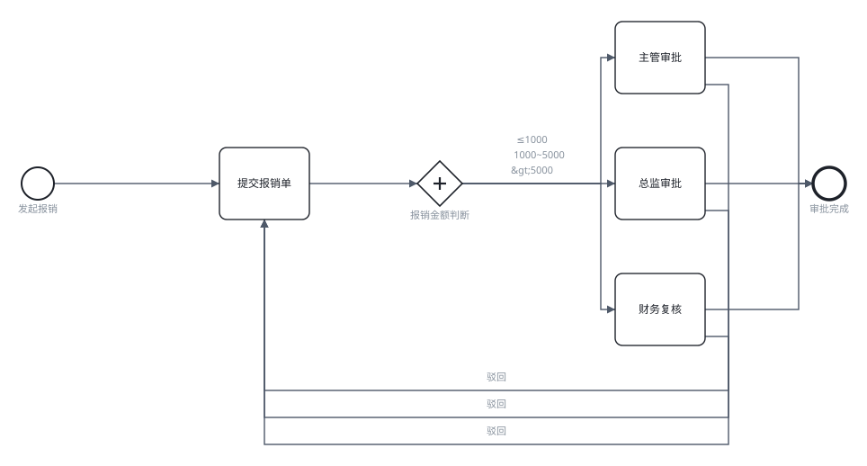
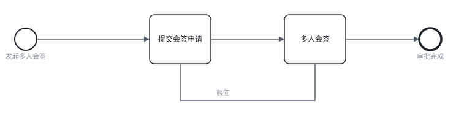

# bpmn-gen：把一句大白话变成能直接跑起来的审批流

[](https://github.com/Alter2007/bpmn-gen/actions/workflows/verify.yml)

> **一句话**：业务人员用中文说一遍审批规则，工具直接生成一个**能被 Flowable / Camunda 直接部署**的 BPMN 文件 —— 不用写代码，也不用去求 IT。

---

## 这个项目解决什么问题（大白话）

企业或政府里的日常办公，如果财务、行政想要一个「报销审批流」，通常要走这么一圈：

```
业务人员 → 提需求 → IT 部门 → 程序员开发 → 反复确认 → 上线
```

问题是：**业务人员不懂代码，程序员不懂业务**。一句话就能说完的规则（"1000 以内主管批，超过 5000 财务复核"），往往要来回沟通好几轮，周期以周计。

这个工具就是为了让业务人员**自己动手**，把这句话直接变成系统能跑的配置，把中间的沟通成本干掉。

典型场景：公文流转、报销、采购、用章、请假、合同会签、投诉信访……凡是「谁在什么条件下审什么」的流程，都适用。

## 它是怎么工作的（三步）

| 步骤 | 你做什么 | 系统做什么 |
|---|---|---|
| **① 说人话** | 输入：`我要做一个差旅报销审批流，金额小于1000直接主管批，超过5000需要财务复核` | 解析关键词，选出最匹配的模板 |
| **② 翻译意图** | —— | 大模型**只输出一个极小的 JSON**（模板 id + 几个参数 + 置信度）；**BPMN XML 由确定性代码生成** |
| **③ 直接运行** | 下载 `.bpmn`，扔进 Flowable / Camunda | 引擎部署即跑，不需要再改 |

> **关键设计**：模型从不写 XML。它的自由度被限制在「理解你说的是哪一类流程、阈值是多少」这一层；语法正确性由代码保证。
> 所以**不会出现"AI 生成的 XML 语法错误"这种事** —— 这类错误在物理上不可能发生。

## 这是什么方向的产品

| 方向 | 我们处在什么位置 |
|---|---|
| **低代码 / 无代码** | ✅ 不用画图、也不用写代码，一句话就行；比拖拽式 BPMN 设计器快得多 |
| **AI 开发工具链** | ✅ AI 负责「意图 → 配置」的翻译，而不是负责生成语法 |
| **行业应用平台（政务 / 企业）** | ✅ 28 个模板覆盖公文、投诉、报销、采购、用章、请假、会签、超时催办等真实场景 |

## 30 秒上手

```bat
:: 形态 ①  命令行：零依赖，只要 Node ≥ 18
nl2bpmn.cmd "差旅报销，金额小于1000主管批，超过5000需要财务复核" -o out.bpmn

:: 形态 ②  桌面应用：双击图标，界面上填一句话
创建桌面快捷方式.cmd     :: 只需运行一次
```

## 两种形态（同一个内核，两个外壳）

本仓库包含**同一引擎的两种用法**。演示视频展示的是**形态 ①**；形态 ② 是视频之后新增的增强外壳。

| | **形态 ① · 命令行版**<br>（⭐ 演示视频展示的就是这一版） | **形态 ② · 桌面应用版**<br>（视频之后新增） |
|---|---|---|
| 怎么打开 | 终端里跑 `demo.cmd` | **双击桌面图标** |
| 要不要命令行 | **要** | **不要** |
| 要不要装依赖 | **不需要**（零依赖，只要 Node ≥ 18） | **要装一次**：`cd web && npm install` |
| 怎么生成 | `nl2bpmn.cmd "…" -o out.bpmn` | 输入一句话 → 点「生成」 |
| 怎么看流程图 | `bpmn2svg.cmd out.bpmn` 出矢量图 | 右侧直接渲染，可缩放拖动 |
| 配套产物 | `--artifacts` 一次落三个文件 | 三个下载按钮 |
| 帮助在哪 | `nl2bpmn.cmd --list` / `--help` | 左侧「使用帮助」（13 页） |
| 适合谁 | 写脚本、接 CI、批量生成 | 演示、给业务人员用、现场讲解 |

> **一句话选**：要**批量 / 自动化**用形态 ①；要**给人看 / 演示**用形态 ②。
>
> 两者共用同一套 `src/` 内核与同一套六层校验，**产出的 BPMN 逐字节一致**。

<details>
<summary>想精确复现演示视频里的版本（点开）</summary>

```bat
git checkout 30b4f85
demo.cmd
```

看完 `git checkout main` 回到最新版。
</details>

## 生成效果（真实输出，非示意图）

两张图都是 `nl2bpmn` 的**实际产物**渲染而来（`scripts/bpmn2svg.js` 直接读 BPMN 的 DI 坐标，不依赖浏览器）。

**① 金额分级 + 三条驳回**（"差旅报销，金额小于1000主管批，超过5000财务复核"）：



**② 多人会签**（"多人会签，全部签完才通过"——人数由 `approvers` 列表长度决定，不写死在流程里）：



## 能力清单（两种形态都支持）

| 能力 | 说明 |
|---|---|
| **审批驳回 / 退回** | 用 BPMN 回边实现：通过 = 默认流，驳回 = 条件 `approved == false`，单子退回发起人重走 |
| **会签 / 或签（人数可配）** | 多实例任务。会签 = 全部签完；或签 = 任意一人签完即通过。**人数由流程变量列表长度决定**，换人增人只改数据 |
| **超时催办** | 任务挂边界定时器，超时未处理自动转升级分支；时长可参数化（说"3 天"就是 `P3D`） |
| **28 个模板，全部带真实分支** | 没有一个只是"提交→审批→结束"的直线：25 个含排他网关，2 个会签/或签，1 个超时边界事件 |
| **中文数字与单位** | `五千`→5000、`两万`→20000、`一万五`→15000、`10万`→100000；`做一个流程` 不会被当成数字 1 |
| **生成提示（不静默替换）** | 阈值没认出来、或你说的档位比模板能放的多，都会**明确告诉你用了什么代替** |
| **交互式澄清** | 关键词把握不大或模型置信度 < 0.7 时**不硬生成**，先摆候选让你点 |
| **配套产物** | 流程说明书（Markdown）、表单定义（JSON）、分支覆盖用例（JSON） |
| **导出 SVG** | 界面和命令行都能出矢量图 |

## 验证记录

一条命令跑完全部六层：`verify-all.cmd`

| 层 | 手段 | 结果 |
|---|---|---|
| 单元/回归 | `node test\run.js` | ✅ **318 项断言** |
| L1 良构 / L0 契约 / L3 图论 | 自研 `xml-lint.js` / `ir.js` / `graph.js` | ✅ |
| L2 规范 | **OMG 官方 XSD** + JDK 17 | ✅ **65/65 文件** |
| L2b 模型 | 第三方 `bpmn-moddle` | ✅ **65/65 文件** |
| L4-lite 引擎 | **Flowable 7.2.0** 官方 `ProcessValidator` | ✅ **65/65 文件** |
| **L4 实例运行** | Flowable + H2 内存引擎：真实部署、启动、走完、路径断言 | ✅ **113 条** |
| **分支覆盖** | `scripts/coverage-specs.js` 按模板自动生成 | ✅ **100 条 / 28 模板** |
| 对照实验基线 | `scripts/compare-raw-xml.js --dry-run` | ✅ 12/12 |

**同一份 BPMN、不同变量走不同分支**（L4 实测）：

```
amount=800   → 提交报销单 → 主管审批
amount=6000  → 提交报销单 → 财务复核
days=9       → 填写请假单 → 人事备案
overseas=true→ 提交出差申请 → 行政审核 → 直属主管审批 → 行政备案
```

> 每次 push 到 GitHub，CI 都会在干净机器上重跑以上全部验证（见 Actions 页）。

## 为什么不让模型直接写 XML

`scripts/compare-raw-xml.js` 用同一批业务描述跑两条路线，**打分规则与路线无关**（良构 → OMG XSD → Flowable 引擎校验），避免自证自评。

```bat
node scripts\compare-raw-xml.js --dry-run --n 12     :: 模板侧，不需要 Key
set DEEPSEEK_API_KEY=sk-xxxx
node scripts\compare-raw-xml.js --n 12               :: 两侧对比，需要 Key
```

当前基线：**模板方案 12/12（100%）**。模型直出一侧的数据由使用者本地跑出，写入 `.data\compare-report.json`。

## 更多细节

| 想了解 | 去哪看 |
|---|---|
| 架构与关键设计决策 | [ARCHITECTURE.md](ARCHITECTURE.md) |
| 演示用示例句 / 视频脚本 | [DEMO-EXAMPLES.md](docs/DEMO-EXAMPLES.md) / [VIDEO-SCRIPT.md](docs/VIDEO-SCRIPT.md) |
| 交付清单与三分钟复现 | [DELIVERABLES.md](docs/DELIVERABLES.md) |
| 环境原则（不污染本机） | [PRINCIPLES.md](PRINCIPLES.md) |
| 第三方组件与许可 | [THIRD-PARTY.md](docs/THIRD-PARTY.md) |
| 作品介绍 PDF（11 页） | [docs/bpmn-gen-report.pdf](docs/bpmn-gen-report.pdf) |

## 目录结构（节选）

```
bpmn-gen/
├─ 【形态①】nl2bpmn.cmd / bpmn2svg.cmd / verify-all.cmd / demo.cmd
├─ 【形态②】创建桌面快捷方式.cmd / 启动应用.vbs / 停止应用.vbs
├─ bin/           CLI 入口
├─ src/           生成内核（零依赖）：ir / graph / layout / serialize / nl / artifacts + 28 个模板
├─ web/           桌面应用（唯一有依赖）：index.html / app.js / serve.js
├─ tools/         Java 单文件验证器：XSD / Flowable 引擎 / 实例运行
├─ test/          318 项断言 + 用例目录
├─ scripts/       bpmn2svg / coverage-specs / compare-raw-xml / 下载脚本
├─ docs/          报告 PDF、架构、交付清单、配图
└─ .github/       CI：每次 push 自动跑六层验证
```

## 环境原则（项目宪法）

- **产物只在工作区内**：用户流程写 `.data\out\`，验证产物写 `.data\verify\`，两者不混。
- **缓存按需下载**：Flowable jar 与 OMG XSD 落在 `.cache\`，删掉可复原。
- **不装软件、不改 PATH、不写注册表**：每次改动前后用 `env-guard.cmd` 体检，红色即排查。
- **Key 只在内存里**：不落盘、不进日志（详见 [PRINCIPLES.md](PRINCIPLES.md)）。

## 开源合规声明

本项目以 **Apache-2.0** 发布。运行时依赖：Node ≥ 18；形态 ② 额外依赖 `bpmn-js`（bpmn.io，MIT）。
校验用的 Flowable 组件与 OMG XSD 只在验证阶段按需下载，不随仓库分发。详见 [THIRD-PARTY.md](docs/THIRD-PARTY.md)。
